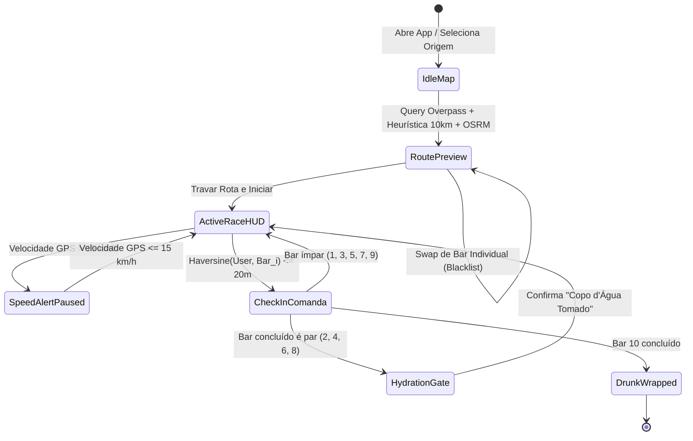

# 🍺 DRUNK — Especificação Técnica e Funcional (Product & Engineering Specs)

> **Versão:** 1.0.0  
> **Stack:** Flutter (Dart) + OpenStreetMap (`flutter_map`) + Overpass API + OSRM + SQLite/Local Storage + FastAPI  
> **Modelo Financeiro de Infraestrutura:** 100% Custo Zero (Open Data & Client-Side First)

---

## 1. Visão do Produto

O **DRUNK** é um aplicativo mobile/web gamificado para grupos de amigos que une **corrida noturna de rua (10 km)** com **maratona de bares (*pub crawl* de 10 paradas)**. O sistema calcula uma rota real caminhável/corrível passando por 10 estabelecimentos reais num total próximo a 10 km, acompanha o deslocamento via GPS com validação anti-trapaça, libera check-ins presenciais por *geofencing*, registra a comanda financeira de cada parada e impõe pausas estratégicas de hidratação.

---

## 2. Personas e Jornada Principal

1. **Host do Grupo (Organizador):** Seleciona o ponto de largada no mapa, gera a rota de 10 km / 10 bares, faz *Swap* de bares indesejados, trava a sessão e opcionalmente compartilha o código da sala (`DRK-XXX`).
2. **Corredor / Participante:** Acompanha o traçado neon no HUD noturno, corre/caminha mantendo velocidade abaixo da trava anti-veículo, realiza check-in a até 20 metros de cada bar, registra quanto gastou na comanda e cumpre os alertas de hidratação até o *Drunk Wrapped* final.



---

## 3. Requisitos Funcionais (Regras de Negócio)

### RF-01 — Descoberta Geográfica de Bares (Overpass API)
- **Entrada:** Coordenada de largada `(lat_0, lng_0)` obtida via GPS (`geolocator`) ou toque direto no mapa, além do raio de busca configurável (`1.5 km` a `6.0 km`, padrão `3.5 km`).
- **Processamento:** Consulta HTTP em `https://overpass-api.de/api/interpreter` filtrando nós e áreas com `amenity=bar`, `amenity=pub` ou `amenity=biergarten` dotados de tag `name`.
- **Fallback Resiliente:** Em caso de indisponibilidade/timeout da API pública ou ambiente de teste sem rede, o sistema aciona gerador determinístico local ao redor de `(lat_0, lng_0)` usando `latlong2`.

### RF-02 — Algoritmo Heurístico de 10 Bares / ~10 km
- **Meta Matemática:** $N = 10$ bares com distância total pelas ruas próxima de $10.000\text{ m}$ ($\approx 1.000\text{ m}$ reais por trecho).
- **Compensação Tortuosidade Urbana:** Como ruas reais possuem fator de tortuosidade médio de $1.25\times$ a $1.32\times$ sobre a linha reta esférica, cada salto busca candidatos na janela de **700 m a 1.200 m (Haversine)** do ponto anterior.
- **Filtro Direcional Angular:** Penaliza candidatos cujo vetor forme ângulo de retorno agudo ($> 120^\circ$) em relação ao deslocamento anterior, evitando ziguezagues repetitivos na mesma quadra.
- **Roteamento de Calçada (OSRM):** Envia os 11 waypoints `(Origem + 10 Bares)` para `/route/v1/foot/` do OSRM para obter a distância real em metros, duração estimada e geometria *polyline* precisa pelas ruas.

### RF-03 — Mecanismo de Swap (Substituição Individual de Bar)
- **Ação:** O usuário toca no botão circular **Swap** ao lado de qualquer Bar $i \in \{1..10\}$.
- **Regra:**
  1. O Bar $i$ atual entra na `sessionBlacklist` para não retornar em futuros swaps da mesma sessão.
  2. Calcula-se o ponto médio geográfico $M$ entre o ponto anterior $P_{i-1}$ (Origem se $i=1$, senão Bar $i-1$) e o ponto seguinte $P_{i+1}$ (Bar $i+1$, ou projeção radial se $i=10$).
  3. Seleciona-se no *pool* de candidatos o estabelecimento válido (fora da rota e fora da *blacklist*) com menor desvio em relação a $M$ e dentro da janela de distância equilibrada.
  4. Recalcula-se a *polyline* e a distância total da rota imediatamente.

### RF-04 — HUD Ativo de Corrida e Trava Anti-Cheat (Velocidade)
- **Telemetria Contínua:** Leitura de posição, velocidade instantânea ($v$ em km/h), ritmo médio (*pace* em `min'seg"/km`) e distância validada acumulada.
- **Regra Anti-Veículo (`MAX_VALID_SPEED = 15.0 km/h` / `4.17 m/s`):**
  - Se $v > 15.0\text{ km/h}$:
    - O incremento de quilometragem validada é **imediatamente suspenso** para os deltas de GPS daquele intervalo.
    - Um banner superior em Vermelho Alerta (`#FF3366`) entra em destaque: *"ALERTA ANTI-CHEAT: Velocidade acima de 15 km/h! Contagem pausada."*
    - O botão de Check-in permanece bloqueado enquanto a velocidade for incompatível com corrida/caminhada a pé.

### RF-05 — Geofencing de Proximidade (20 Metros)
- **Cálculo:** A cada atualização de coordenada, calcula-se $d = \text{Haversine}(P_{\text{usuário}}, P_{\text{bar\_alvo}})$ em metros.
- **Estado Travado ($d > 20\text{ m}$):** Botão inferior exibe distância restante em tempo real (ex.: `"FALTAM 145m PARA DESTRAVAR CHECK-IN"`), visualmente inativo.
- **Estado Liberado ($d \le 20\text{ m}$):** Botão pulsa em Verde Cyber (`#00FF66`) com feedback tátil (`HapticFeedback.heavyImpact`) e rótulo `"FAZER CHECK-IN NO BAR #0X"`.

### RF-06 — Comanda Financeira por Parada
- **Gatilho:** Toque em `"FAZER CHECK-IN"` dentro do raio de 20 metros.
- **Entradas do Modal:**
  - Valor monetário gasto na parada em Reais (`R$ 0,00` permitido caso não tenha consumido bebida paga, ou valores rápidos `+R$ 15`, `+R$ 25`, `+R$ 50` + edição livre).
  - Categoria rápida de consumo (*Chopp / Cerveja*, *Drink / Dose*, *Água / Isotônico*, *Petisco*).
  - Nota opcional curta.
- **Efeito de Estado:**
  - Soma o valor ao `totalSpentBrl` da corrida e grava imediatamente no banco local (`sqflite` / `shared_preferences`).
  - Pino do bar no mapa muda de Laranja Neon (`#FF5E00`) para Verde Cyber (`#00FF66`) e o trecho concluído da *polyline* fica verde.

### RF-07 — Segurança & Gamificação: Trava Obrigatória de Hidratação
- **Gatilho:** Conclusão de cada múltiplo de 2 bares (**Bar 2, Bar 4, Bar 6 e Bar 8**).
- **Comportamento:** Exibe modal bloqueante (`PopScope(canPop: false)`) em Ciano Neon (`#00E5FF`) exigindo que o corredor confirme a ingestão de 1 copo d'água antes de liberar as coordenadas do próximo bar.

### RF-08 — Resumo Pós-Prova ("Drunk Wrapped") & DrunkCoins
- **Gatilho:** Confirmação do check-in no **Bar 10**.
- **Cálculo de Recompensa (`DrunkCoins`):**
  $$\text{DrunkCoins} = (\text{Bares Concluídos} \times 80) + \lfloor \text{KM Validados} \times 45 \rfloor + (\text{Hidratações Confirmadas} \times 50) - (\text{Alertas Anti-Cheat} \times 25)$$
- **Saída:** Card arcade vertical de alta legibilidade contendo distância total validada, tempo total, *pace* médio, gasto total da comanda (`R$`), média por bar (`R$/bar`), mini-mapa da rota 100% verde e ação de compartilhamento.

---

## 4. Requisitos Não-Funcionais (RNF)

| Código | Categoria | Especificação |
| :--- | :--- | :--- |
| **RNF-01** | **Custo Zero** | Nenhuma dependência de Google Maps Billing, Mapbox pago ou servidores proprietários pagos. Uso exclusivo de OSM/CartoDB, Overpass, Nominatim e OSRM. |
| **RNF-02** | **Multiplataforma Dev/Prod** | Código único Flutter compilável para **Android APK**, **Linux Desktop** e **Web Server** (`flutter run -d web-server`). |
| **RNF-03** | **Offline Resilience** | Após travar a rota, a sessão inteira, os 10 bares, a *polyline* codificada e todos os lançamentos da comanda financeira ficam salvos localmente, sobrevivendo ao fechamento do app. |
| **RNF-04** | **Usabilidade Noturna** | Contraste mínimo WCAG AA em ambiente externo noturno, alvos de toque $\ge 48 \times 48\text{ dp}$ para uso em movimento/corrida e números condensados gigantes para leitura em 1 segundo. |
| **RNF-05** | **Modo Simulação Dev** | Controles de simulação de passo/GPS em modo debug para testar aproximação $\le 20\text{ m}$ e disparo de velocidade $> 15\text{ km/h}$ diretamente no navegador (`web-server`) ou desktop. |

---

## 5. Modelo de Dados Local (Persistência)

### 5.1. Sessão de Corrida (`race_sessions`)
```json
{
  "session_id": "drk_20261029_001",
  "room_code": "DRK-492",
  "status": "ACTIVE",
  "origin_lat": -23.5568,
  "origin_lng": -46.6622,
  "origin_label": "Rua Augusta, Consolação",
  "planned_distance_m": 10240.0,
  "validated_distance_m": 4210.5,
  "elapsed_seconds": 1540,
  "current_bar_index": 4,
  "hydration_count": 2,
  "anti_cheat_warnings": 0,
  "total_spent_brl": 78.50,
  "polyline_points": [[-23.5568, -46.6622], [-23.5581, -46.6640]],
  "started_at": "2026-10-29T20:00:00Z",
  "finished_at": null
}
```

### 5.2. Parada e Comanda (`bar_checkins`)
```json
{
  "session_id": "drk_20261029_001",
  "bar_order": 3,
  "bar_id": "osm_node_4829104",
  "bar_name": "Boteco Neon Augusta",
  "lat": -23.5542,
  "lng": -46.6598,
  "leg_distance_m": 980.0,
  "checked_in": true,
  "checked_in_at": "2026-10-29T20:38:12Z",
  "distance_at_checkin_m": 14.2,
  "spent_brl": 28.00,
  "drink_category": "CHOPP",
  "notes": "IPA 500ml"
}
```

---

## 6. Especificação de Telas (Catálogo UI/UX)

1. **`RouteFinderScreen` (Tela 1 — Buscador e Gerador 10KM):** Mapa Dark Matter 100% da tela, cabeçalho flutuante de GPS + presets de bairros boêmios, seletor de raio, botão neon `"GERAR ROTA DRUNK (10KM)"`, banner de métricas reais e lista ordenada do Bar 1 ao Bar 10 com botão individual de **Swap** e CTA `"TRAVAR ROTA E INICIAR"`.
2. **`RaceActiveHudScreen` (Tela 2 — HUD Ativo de Corrida):** Painel de telemetria estilo *Nike Run Club noturno* sobre o mapa vivo, velocímetro instantâneo, *pace*, progresso de KM, banner retrátil vermelho de **Anti-Cheat (`> 15 km/h`)** e card do próximo bar com radar de proximidade (`20m` geofence).
3. **`CheckInComandaModal` (Tela 3 — Check-in & Comanda Financeira):** Gaveta modal cyberpunk acionada ao atingir $\le 20\text{ m}$ do bar alvo, com visor grande em `R$`, atalhos `+R$ 15 / +R$ 25 / +R$ 50`, seletor de bebida e confirmação que pinta o bar de `#00FF66`.
4. **`HydrationLockModal` (Tela 4 — Trava Obrigatória de Hidratação):** Overlay imersivo de segurança em Ciano Neon (`#00E5FF`) exibido obrigatoriamente nos bares 2, 4, 6 e 8 exigindo confirmação de ingestão de água.
5. **`DrunkWrappedScreen` (Tela 5 — Resumo Final & DrunkCoins):** Card arcade pós-corrida com os 10 km concluídos, *pace* final, somatório da comanda em `R$`, recompensa em `DrunkCoins` e botão de compartilhamento social.
